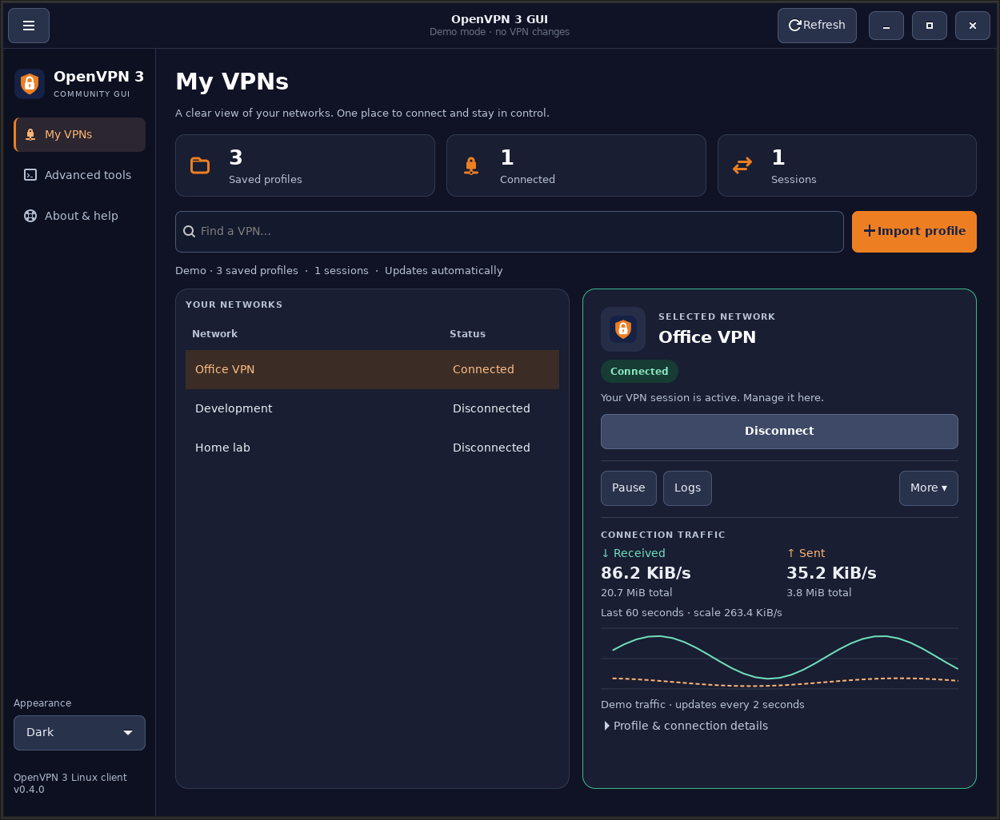
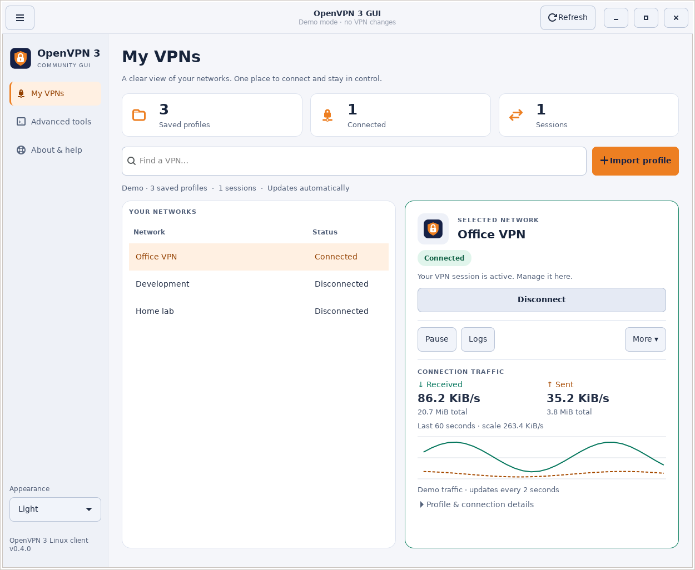
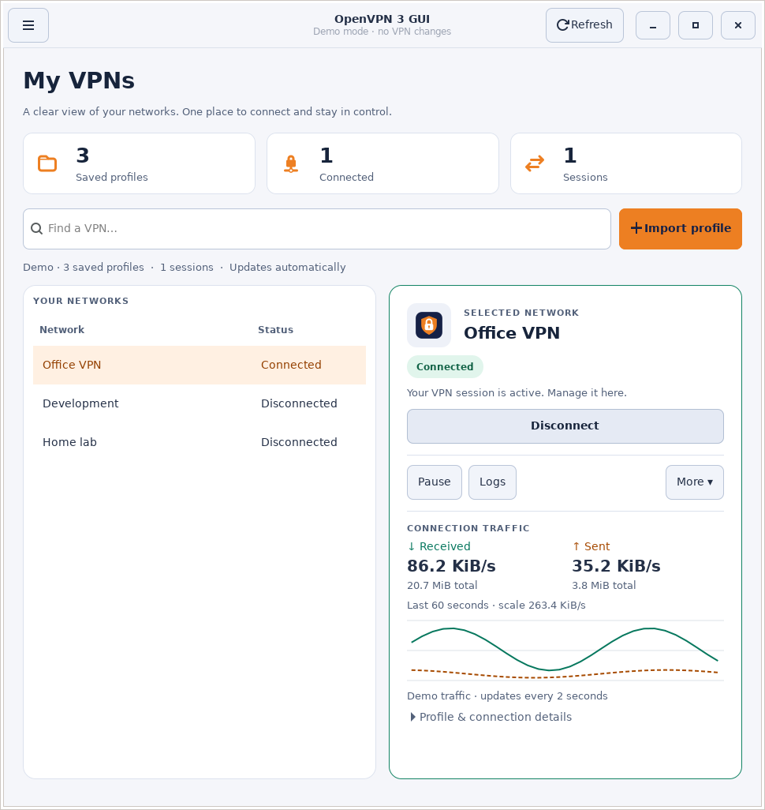
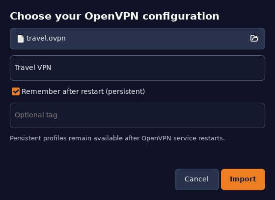
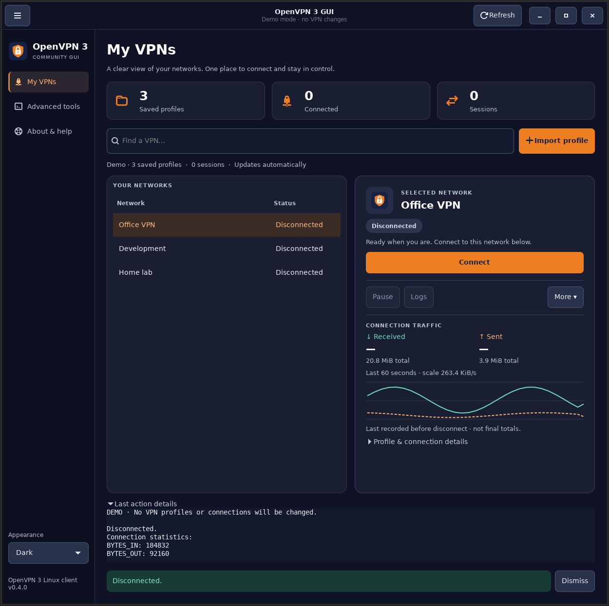
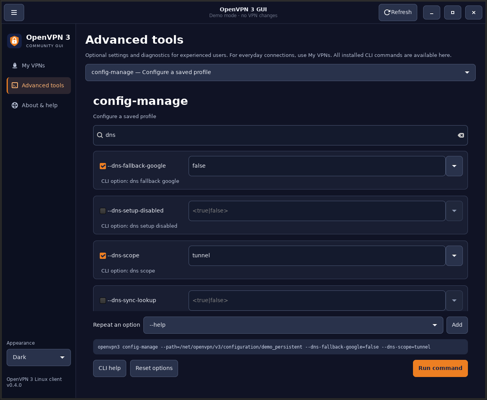
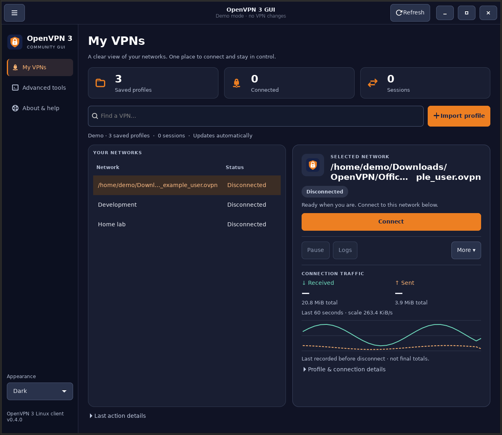
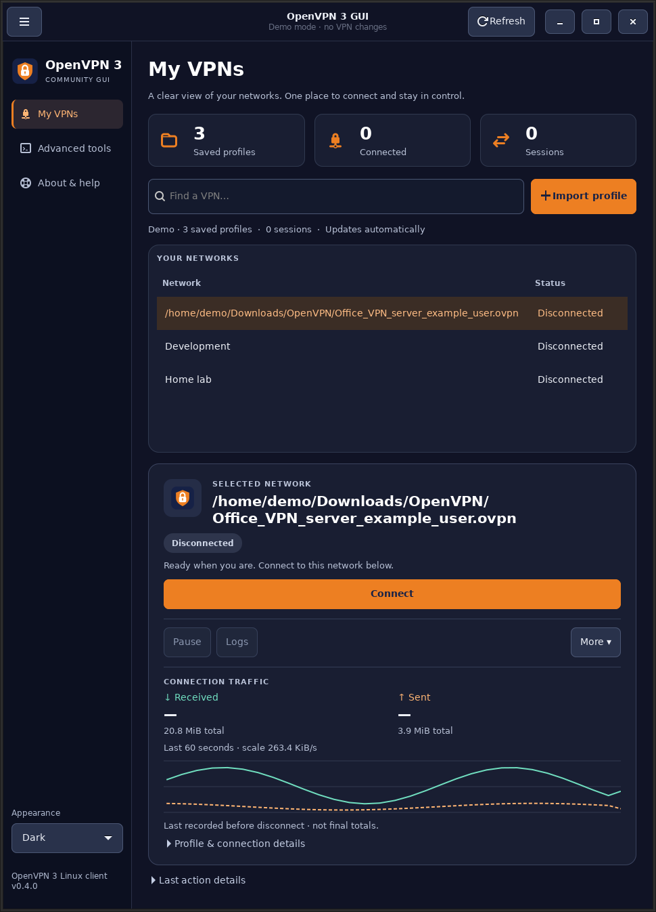

<p align="center">
  
</p>

# OpenVPN 3 GUI

**Your VPN profiles and connections, in one native Linux desktop app.**

A GTK companion for OpenVPN 3 Linux on Debian and Ubuntu. Import a profile, connect, and manage the session from one screen. The full installed CLI remains available through graphical option forms.

This is an independent community project, not OpenVPN Connect, and is not affiliated with or endorsed by OpenVPN Inc.

[Download releases](https://github.com/shuvo072/openvpn3-gui/releases) · [Get started](#get-started) · [Screenshots](#everyday-use) · [Testing](docs/TESTING.md) · [Contributing](CONTRIBUTING.md) · [MIT license](LICENSE)



*Screenshots use isolated demo data. No real profiles, credentials, or server addresses are shown.*

The light and dark interfaces with orange accents take visual cues from [OpenVPN Connect](https://openvpn.net/client/) and the [published OpenVPN palette](https://openvpn.net/branding/). The shield-and-lock artwork is this project's own icon. Official OpenVPN/Connect logos are not bundled: [OpenVPN's trademark policy](https://openvpn.net/legal/) requires prior written consent for their use. OpenVPN is a registered trademark of OpenVPN Inc. The app uses Inter when installed, with a system sans-serif fallback.

## What it does

- **One workspace:** saved profiles and active sessions appear together, with Connect/Disconnect, Pause/Resume, statistics, and logs.
- **Live traffic:** received/sent speeds, session totals, and a 60-second chart directly in the connection card.
- **Your preferred appearance:** follows the desktop by default; choose Light or Dark in the collapsible sidebar.
- **Quiet routine actions:** disconnect and other everyday changes finish inline. Successful authentication windows close automatically; errors stay available.
- **Duplicate names handled correctly:** actions use exact D-Bus identifiers. A running connection stays associated with its profile even after a rename.
- **Full CLI access:** commands, aliases, values, and descriptions are discovered from your installed `openvpn3 --help`. OpenVPN 3 v27.1 exposes 16 commands and 115 command options.
- **Interactive authentication:** a real terminal supports OpenVPN's password, OTP, and other interactive prompts. Copy web-authentication URLs into your browser when needed.
- **Local by design:** no application account, telemetry, cloud service, or web server. The app does not persist passwords or command history.

## Get started

For a ready-to-install package, open [GitHub Releases](https://github.com/shuvo072/openvpn3-gui/releases) and download the `.deb`, `install-openvpn3-gui.sh`, and `SHA256SUMS` from the same release. Follow [the package installation instructions](#share-the-deb-with-users) below. Building from source is optional.

### 1. Install the prerequisites

For real connections, install **OpenVPN 3 Linux** using the [official OpenVPN installation guide](https://openvpn.net/community-docs/openvpn-client-for-linux.html). The `openvpn3` package comes from OpenVPN's repository; it is different from the classic `openvpn` package.

Install the desktop libraries:

```sh
sudo apt install python3-gi python3-cairo python3-gi-cairo gir1.2-gtk-3.0 gir1.2-vte-2.91 adwaita-icon-theme librsvg2-common
```

### 2. Run from source

From a downloaded or cloned copy of this project:

```sh
cd Openvpn3-GUI
./openvpn3-gui
```

Run as your **normal desktop user**, without `sudo`. There are no pip dependencies for the application.

To explore without OpenVPN, a VPN account, or network changes:

```sh
./openvpn3-gui --demo
```

Demo mode simulates profiles, connections, authentication, and errors. Any nonempty username/password works. If OpenVPN is absent, a bundled demo catalog supplies the option forms. Real mode always discovers the installed CLI.

### 3. Install as a desktop application

Build and install the Debian package:

```sh
make install
```

Run this as your normal user. The build runs without root; the installer requests `sudo` only for APT, which asks you to confirm any package changes. It stages the package in a temporary directory readable by APT's `_apt` user and removes the copy afterward. This avoids the “Download is performed unsandboxed as root” notice when the project is inside a private home directory, without changing your home permissions or disabling APT's sandbox.

To build without installing, use `make deb`. To install an already built or downloaded package from this checkout:

```sh
./scripts/install-deb.sh ./dist/openvpn3-gui_0.4.0_all.deb
```

Launch **OpenVPN 3 GUI** from your application menu or run `openvpn3-gui`.

Upgrade by installing a newer `.deb` the same way, then close and reopen the app. To uninstall:

```sh
sudo apt remove openvpn3-gui
```

Removing the GUI leaves OpenVPN's imported profiles and connections intact.

### Share the `.deb` with users

The distributable package is **`dist/openvpn3-gui_0.4.0_all.deb`**. It installs the application, desktop launcher, icon, manual, and documentation into standard system locations. Recipients do not need this source checkout, Python development tools, or `make`. APT resolves the declared runtime dependencies; recipients must first configure the [official OpenVPN 3 repository](https://openvpn.net/community-docs/openvpn-client-for-linux.html) for their supported distribution if OpenVPN 3 is not already installed.

Users can open the `.deb` with their desktop's package installer, if available. For terminal installation, distribute the optional **`dist/install-openvpn3-gui.sh`** alongside it. From the directory containing both downloaded files:

```sh
sh ./install-openvpn3-gui.sh ./openvpn3-gui_0.4.0_all.deb
```

The helper works without the source checkout and stages the package for APT's sandbox. The `.deb` cannot control permissions on the directory it is downloaded into: a direct `sudo apt install ./package.deb` from a private home directory can still print the `_apt` notice. Neither installation method downloads or runs an unverified bootstrap script or changes home-directory permissions.

The build also writes `dist/SHA256SUMS` for the package and helper. Distribute it with the two files; recipients can run `sha256sum --check SHA256SUMS` to check download integrity. These checksums are not a publisher signature.

## Everyday use

### Appearance and navigation

Use the **☰** button at the top left to hide or show navigation. Hiding it gives the connection panel more space. The footer identifies the app as an **OpenVPN 3 Linux client**; licensing information is in **About & help**.

**Appearance → System default** follows your desktop's light/dark preference, including changes while the app is open. You can also select **Light** or **Dark**. The app uses the desktop settings portal, with GNOME/GTK settings as a fallback; it does not change your desktop theme. If your desktop does not expose a preference, choose a mode manually.

Only the appearance choice is saved, in `$XDG_CONFIG_HOME/openvpn3-gui/preferences.json` (normally `~/.config/openvpn3-gui/preferences.json`). Demo mode does not read or write this preference. Remove the file to restore System default.





### Import a profile

Choose **Import profile**, select your `.ovpn` file, and give it a friendly name. **Remember after restart** is enabled by default. The import form prevents accidental duplicate names.



### Connect and disconnect

1. Select a network under **My VPNs**.
2. Choose **Connect** and respond to any authentication prompts.
3. After success, the prompt closes and the dashboard updates.
4. Choose **Disconnect** to end the selected session. No terminal popup is left behind.

The app refreshes automatically every five seconds and after actions finish. If a profile has multiple sessions, choose the exact connection from its selector. Sessions whose profiles are unavailable remain manageable as separate rows.

### Read connection traffic

The connection card shows **Received** and **Sent** speeds, total transferred bytes, and a graph of the last 60 seconds. It samples the selected connected session about every two seconds, using its exact ID. The solid teal line is received traffic; the dashed orange line is sent traffic. Speeds need two samples before appearing.

Totals are OpenVPN's TCP/UDP transport counters (`BYTES_IN` / `BYTES_OUT`), including VPN overhead, and cover the session even if it started before the GUI. The graph only covers samples collected while that session is selected. Units are bytes (KiB = 1,024 bytes), not bits. See the [upstream counter definitions](https://github.com/OpenVPN/openvpn3-linux/blob/master/docs/dbus/dbus-service-net.openvpn.v3.client.md#dictionary-statistics).

Pauses, delayed reads, and errors are labelled; missing readings do not become zero-speed measurements. Counter resets start a fresh speed baseline. Traffic history stays in memory and is discarded when the app closes. After disconnect, the card retains a clearly labelled **last recorded** snapshot; the CLI's final disconnect statistics remain under **Last action details**. **More → Raw statistics** opens all counters when needed.

Disconnect details:



**Closing the GUI does not disconnect an established VPN.** OpenVPN's background services manage the tunnel. Use Disconnect when you want to end it.

### Manage profiles and connections

**More** contains raw statistics, rename, profile settings, access permissions, export, deletion, restart, authentication requests, and stale-session cleanup. **Profile & connection details** shows the full identifiers and service-reported information.

Configuration exports use owner-only file permissions (`0600`). Exports can contain private keys; store them in a location you trust. Deleting an imported profile does not delete the original `.ovpn` file. Deletion and permanent sealing require confirmation.

### Use advanced options

Open **Advanced tools**, select a command, and enable the options you need. Search filters the available fields. **Repeat an option** supports repeated tags or access grants; **Reset options** clears the form. The command preview masks secret-valued fields.

This section is optional. Most users only need **My VPNs** to import, connect, and disconnect; Advanced tools exposes settings such as DNS, proxy configuration, access permissions, and diagnostics.



An enabled optional-value flag with an empty value is sent without a value: for example, `--log-level` queries the level instead of setting one. Short aliases appear in tooltips. OpenVPN validates conflicting options and permission restrictions.

This interface covers the `openvpn3` binary. Separate administration tools such as `openvpn3-admin` and system-service configuration remain outside its scope.

## Keyboard shortcuts

| Shortcut | Action |
| --- | --- |
| `Ctrl+F` | Focus the VPN search |
| `Ctrl+I` | Import a profile |
| `Ctrl+R` | Refresh profiles and sessions |
| `Ctrl+Q` | Close the application, with running-action checks |
| `Tab` / `Shift+Tab` | Move between controls |
| `Ctrl+Shift+C` / `Ctrl+Shift+V` | Copy/paste in a command terminal |

Status is expressed in text as well as color. Cards switch from side by side to stacked based on available content width, and the page scrolls vertically at smaller sizes. Long profile names fit within the card; hover over the heading to read the full original name. Actions continue to use the exact profile ID. The minimum window size is 960 × 680 logical pixels.





## Requirements and compatibility

- Debian or Ubuntu desktop with a working graphical session and system D-Bus.
- Python 3.9+, PyGObject, GTK 3, Pycairo/GI Cairo, and VTE 2.91.
- OpenVPN 3 Linux with `configs-list --json` for profile management and `session-stats --json` for live traffic.

The `.deb` contains architecture-independent Python code; OpenVPN and distribution packages determine the supported CPU architectures. Development uses OpenVPN 3 Linux v27.1. [Test results and their limits](docs/TESTING.md) distinguish desktop simulation, installed-CLI checks, and real VPN/server testing.

## Troubleshooting

| Symptom | What to do |
| --- | --- |
| OpenVPN is not installed | Use the setup screen's official installation link, then **Check again**. **Explore demo** works without OpenVPN. |
| Profile/session service unavailable | Confirm `openvpn3 configs-list --json` and `openvpn3 sessions-list` work as your desktop user, then choose **Refresh**. |
| Live traffic unavailable | The app retries automatically. Check **More → Raw statistics** for CLI diagnostics and whether your installed CLI supports `session-stats --json`. |
| Authentication fails | Read the error in the command window. Check the username, password/OTP, and server requirements. |
| An action times out | Refresh before retrying: the service may already have applied it. Diagnostics remain available. |
| The desktop cannot open | Launch from a graphical desktop session, using the system Python through `./openvpn3-gui`. |
| A session appears separately | Its profile may have been deleted or its identity may be inaccessible. The app leaves it separate rather than guessing by name. |
| A command fails with permission denied | Run as the same user that owns the profile, or have its owner adjust the OpenVPN ACL. Do not run the GUI with sudo. |

When reporting a problem, include the app version (`./openvpn3-gui --version`), OS, OpenVPN version, and sanitized error text. Do not attach `.ovpn` files, passwords, private keys, or unredacted connection logs. See [SECURITY.md](SECURITY.md) for private reports.

## Development

```sh
make test           # backend tests; installed CLI coverage when available
make check          # full desktop, shell, and packaging checks; needs a display
make screenshots    # regenerate README screenshots using demo data only
make deb            # build an installable package
```

[CONTRIBUTING.md](CONTRIBUTING.md) lists test dependencies, headless commands, architecture, and contribution guidance. The checked-in CI workflow runs the suite on Ubuntu 22.04/24.04 and Debian 12/13. Package checks verify the extracted launcher, required assets, file permissions, checksums, and reproducible builds.

## License and maintainer

[MIT](LICENSE) © 2026 Mehadi Hasan Shuvo and contributors.

Maintainer: **Mehadi Hasan Shuvo** — [hasanshuvo.dev@gmail.com](mailto:hasanshuvo.dev@gmail.com).

OpenVPN 3 GUI is an independent project, not affiliated with or endorsed by OpenVPN Inc. OpenVPN is a trademark of OpenVPN Inc. OpenVPN, GTK, and VTE are separately installed dependencies with their own licenses.
